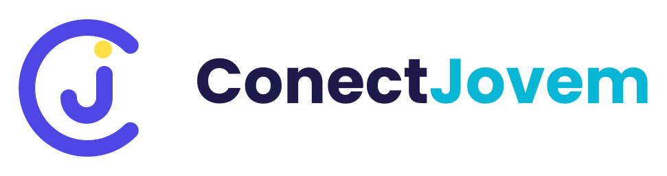

<p align="center">
  <picture>
    <source media="(prefers-color-scheme: dark)" srcset="src/assets/logo/logo-horizontal-fundo-escuro.svg">
    
  </picture>
</p>

<p align="center">
  Gestão de ministério jovem: jovens, grupos, encontros, chamada, alertas de faltas e acompanhamento.
  <br>
  <a href="https://conectjovem.com.br"><strong>conectjovem.com.br</strong></a>
</p>

---

## O que é

O ConectJovem ajuda a coordenação e os líderes de um ministério jovem a saber **quem está presente, quem sumiu e quem precisa de um cuidado**. Tudo em português, pensado primeiro para o celular.

Fluxo principal: **Jovens → Grupos → Encontros → Chamada → Histórico → Alertas → Tarefas**.
Ao salvar uma chamada, o banco recalcula as faltas consecutivas de cada jovem e abre um alerta quando o limite configurado é atingido. A partir do alerta cria-se uma tarefa de acompanhamento (ex.: "Ligar para o jovem"); concluir a tarefa resolve o alerta.

## Funcionalidades

- **Jovens e grupos**: cadastro, situação (normal, atenção, crítico), ações em lote e anonimização de dados (irreversível, só coordenador).
- **Encontros**: avulsos ou recorrentes (séries), com os grupos participantes.
- **Chamada**: presente, ausente ou não registrado (não registrado nunca conta como falta).
- **Alertas**: faltas consecutivas, frequência baixa, queda de frequência, jovem sem acompanhamento e ação atrasada.
- **Acompanhamento e tarefas**: responsável por jovem, transferência com histórico e tarefas vinculadas a alertas.
- **Comunicação por e-mail**: envio pelo servidor, com revisão antes de enviar e histórico do resultado.
- **Relatórios**: geral, frequência, grupos, alertas, acompanhamento e individual, com exportação em CSV e PDF.
- **Busca global**, **histórico de atividades** e **modo escuro**.
- **Dois papéis**: coordenador (acesso total) e líder (somente os próprios grupos), com a autorização garantida por RLS no banco.

## Stack

| Camada | Tecnologia |
|---|---|
| Interface | React 19, TypeScript, Vite 8, Tailwind CSS v4 |
| Dados e autenticação | Supabase (Postgres, Auth, Row Level Security, Edge Function) |
| E-mail | Resend, só pelo servidor |
| Hospedagem | Cloudflare Workers (arquivos estáticos) |
| Testes | Vitest + PGlite (unitários e de banco) e Playwright (E2E) |

Não há backend próprio: o frontend conversa direto com o Supabase, e a segurança vem do RLS, das RPCs e da CSP.

## Rodando localmente

Requisitos: Node.js 24 e um projeto Supabase.

```bash
cp .env.example .env     # preencha VITE_SUPABASE_URL e VITE_SUPABASE_PUBLISHABLE_KEY
npm install
npm run dev
```

Use só a chave *publishable* (anon) do projeto. A `service_role` nunca entra no frontend.

| Comando | Para quê |
|---|---|
| `npm run dev` | Servidor de desenvolvimento |
| `npm run build` | Verificação de tipos e build de produção |
| `npm run lint` | Lint (oxlint) |
| `npm test` | Testes unitários e de banco (PGlite) |
| `npm run test:e2e` | E2E com Playwright contra um Supabase falso local (ver `tests/e2e/README.md`) |
| `npm run smoke -- https://conectjovem.com.br` | Teste de fumaça do site publicado (só leitura) |

## Estrutura

```
src/            aplicação React (páginas, componentes, hooks, contextos, lib)
supabase/       migrations SQL (fonte da verdade do schema) e a Edge Function send-communication
tests/          testes de banco (PGlite), E2E (Playwright) e concorrência em Postgres real
docs/           guias de operação, e-mail, privacidade, observabilidade e redesign
scripts/        utilitários (teste de fumaça, ícones, dados de teste)
```

## Documentação

- [Operação, banco de dados e configuração](docs/OPERACAO.md): migrations, autenticação, CSP, papéis e parâmetros
- [Entrega em produção (go-live)](docs/GO-LIVE.md)
- [Autenticação e e-mails do Auth](docs/AUTH-EMAIL.md) e [envio de comunicações](docs/EMAIL.md)
- [Privacidade](docs/PRIVACIDADE.md) e [retenção de dados](docs/RETENCAO.md) (rascunhos para validação jurídica)
- [Observabilidade](docs/OBSERVABILIDADE.md)
- [Design system e redesign](docs/REDESIGN.md)

## Segurança e privacidade

O sistema trata dados pessoais de jovens, inclusive menores. Por isso o acesso é sempre mediado por RLS, o cadastro aberto é desligado e os segredos ficam só no servidor. Para reportar uma vulnerabilidade, veja o [SECURITY.md](SECURITY.md).

## Contribuindo

Veja o [CONTRIBUTING.md](CONTRIBUTING.md) para o fluxo de trabalho, as convenções e as verificações antes de abrir um PR.

## Licença

Sem licença de código aberto definida: todos os direitos reservados ao autor.
